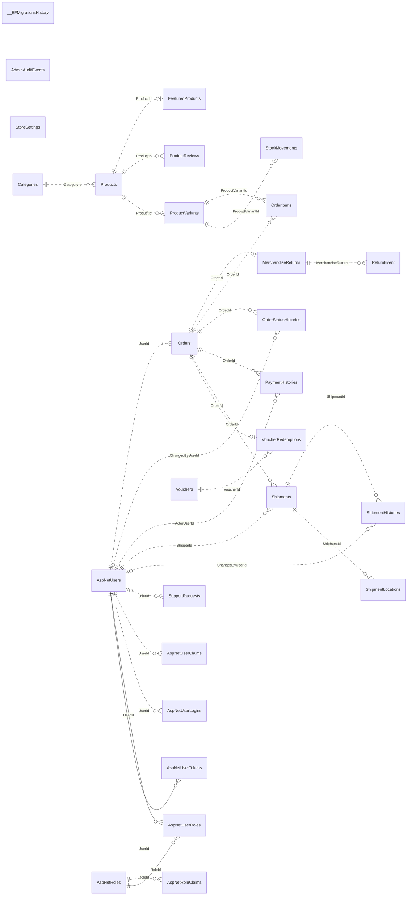

# Sơ đồ cơ sở dữ liệu FashionStore

Schema SQL Server của ứng dụng chính, theo EF Core model snapshot và migration `20261113225717_AddCheckoutRequestId`. Gồm **27 bảng ứng dụng** (kể cả ASP.NET Identity), **28 khóa ngoại** và **1 bảng lịch sử migration**.

## Sơ đồ tổng quan

Mỗi đường mang tên cột khóa ngoại. Ký hiệu `||` là đúng một, `o|` hoặc `|o` là không hoặc một, `o{` là không hoặc nhiều. Nét liền biểu thị khóa ngoại nằm trong khóa chính của bảng con.

## Sơ đồ chi tiết

```mermaid
erDiagram
    direction LR
    __EFMigrationsHistory {
        nvarchar(150) MigrationId PK "NOT NULL"
        nvarchar(32) ProductVersion "NOT NULL"
    }
    AdminAuditEvents {
        bigint Id PK "NOT NULL"
        nvarchar(60) Action "NOT NULL"
        nvarchar(450) ActorId "NULL · Logic: AspNetUsers.Id"
        datetime2 CreatedAt "NOT NULL"
        nvarchar(1000) Detail "NOT NULL"
        nvarchar(80) Target "NOT NULL"
    }
    AspNetRoleClaims {
        int Id PK "NOT NULL"
        nvarchar(max) ClaimType "NULL"
        nvarchar(max) ClaimValue "NULL"
        nvarchar(450) RoleId FK "NOT NULL"
    }
    AspNetRoles {
        nvarchar(450) Id PK "NOT NULL"
        nvarchar(max) ConcurrencyStamp "NULL"
        nvarchar(256) Name "NULL"
        nvarchar(256) NormalizedName "NULL"
    }
    AspNetUserClaims {
        int Id PK "NOT NULL"
        nvarchar(max) ClaimType "NULL"
        nvarchar(max) ClaimValue "NULL"
        nvarchar(450) UserId FK "NOT NULL"
    }
    AspNetUserLogins {
        nvarchar(450) LoginProvider PK "NOT NULL"
        nvarchar(450) ProviderKey PK "NOT NULL"
        nvarchar(max) ProviderDisplayName "NULL"
        nvarchar(450) UserId FK "NOT NULL"
    }
    AspNetUserRoles {
        nvarchar(450) UserId PK, FK "NOT NULL"
        nvarchar(450) RoleId PK, FK "NOT NULL"
    }
    AspNetUsers {
        nvarchar(450) Id PK "NOT NULL"
        int AccessFailedCount "NOT NULL"
        nvarchar(max) ConcurrencyStamp "NULL"
        datetime2 CreatedAt "NOT NULL"
        nvarchar(256) Email "NULL"
        bit EmailConfirmed "NOT NULL"
        nvarchar(max) FullName "NOT NULL"
        bit IsActive "NOT NULL"
        bit LockoutEnabled "NOT NULL"
        datetimeoffset LockoutEnd "NULL"
        nvarchar(256) NormalizedEmail "NULL"
        nvarchar(256) NormalizedUserName "NULL"
        nvarchar(max) PasswordHash "NULL"
        nvarchar(max) PhoneNumber "NULL"
        bit PhoneNumberConfirmed "NOT NULL"
        nvarchar(max) SecurityStamp "NULL"
        bit TwoFactorEnabled "NOT NULL"
        nvarchar(256) UserName "NULL"
    }
    AspNetUserTokens {
        nvarchar(450) UserId PK, FK "NOT NULL"
        nvarchar(450) LoginProvider PK "NOT NULL"
        nvarchar(450) Name PK "NOT NULL"
        nvarchar(max) Value "NULL"
    }
    Categories {
        int Id PK "NOT NULL"
        bit IsActive "NOT NULL"
        nvarchar(max) Name "NOT NULL"
        nvarchar(max) Slug "NOT NULL"
    }
    FeaturedProducts {
        int Id PK "NOT NULL"
        int Position "NOT NULL"
        int ProductId FK, UK "NOT NULL"
    }
    MerchandiseReturns {
        int Id PK "NOT NULL"
        datetime2 CreatedAt "NOT NULL"
        nvarchar(500) Evidence "NULL"
        int OrderId FK, UK "NOT NULL"
        nvarchar(500) Reason "NOT NULL"
        decimal RefundAmount "decimal(18,2) · NOT NULL"
        int State "NOT NULL"
    }
    OrderItems {
        int Id PK "NOT NULL"
        nvarchar(max) Color "NOT NULL"
        int OrderId FK "NOT NULL"
        nvarchar(max) ProductName "NOT NULL"
        int ProductVariantId FK "NOT NULL"
        int Quantity "NOT NULL"
        nvarchar(max) SKU "NOT NULL"
        nvarchar(max) Size "NOT NULL"
        decimal UnitPrice "decimal(18,2) · NOT NULL"
    }
    Orders {
        int Id PK "NOT NULL"
        nvarchar(max) Address "NOT NULL"
        uniqueidentifier CheckoutRequestId "NULL"
        datetime2 CreatedAt "NOT NULL"
        decimal DiscountAmount "decimal(18,2) · NOT NULL"
        bit InventoryRestored "NOT NULL"
        nvarchar(450) OrderCode UK "NOT NULL"
        int PaymentMethod "NOT NULL"
        int PaymentStatus "NOT NULL"
        nvarchar(max) Phone "NOT NULL"
        nvarchar(max) ReceiverName "NOT NULL"
        rowversion RowVersion "NOT NULL"
        decimal ShippingFee "decimal(18,2) · NOT NULL"
        int Status "NOT NULL"
        decimal SubTotal "decimal(18,2) · NOT NULL"
        decimal TotalAmount "decimal(18,2) · NOT NULL"
        datetime2 TransferReportedAt "NULL"
        nvarchar(450) UserId FK "NOT NULL"
    }
    OrderStatusHistories {
        int Id PK "NOT NULL"
        nvarchar(450) ChangedByUserId FK "NULL"
        datetime2 CreatedAt "NOT NULL"
        int NewStatus "NOT NULL"
        nvarchar(500) Note "NULL"
        int OldStatus "NULL"
        int OrderId FK "NOT NULL"
    }
    PaymentHistories {
        int Id PK "NOT NULL"
        nvarchar(450) ActorUserId FK "NULL"
        decimal Amount "decimal(18,2) · NOT NULL"
        datetime2 CreatedAt "NOT NULL"
        nvarchar(40) Event "NOT NULL"
        int NewStatus "NOT NULL"
        int OldStatus "NOT NULL"
        int OrderId FK "NOT NULL"
    }
    ProductReviews {
        int Id PK "NOT NULL"
        nvarchar(1000) Comment "NOT NULL"
        datetime2 CreatedAt "NOT NULL"
        bit IsReported "NOT NULL"
        bit IsVisible "NOT NULL"
        int ProductId FK "NOT NULL"
        int Rating "NOT NULL"
        nvarchar(450) UserId "NOT NULL · Logic: AspNetUsers.Id"
    }
    Products {
        int Id PK "NOT NULL"
        int CategoryId FK "NOT NULL"
        datetime2 CreatedAt "NOT NULL"
        nvarchar(max) Description "NOT NULL"
        nvarchar(max) ImageUrl "NOT NULL"
        bit IsActive "NOT NULL"
        nvarchar(max) Name "NOT NULL"
        decimal Price "decimal(18,2) · NOT NULL"
        nvarchar(16) ShowroomAudience "NULL"
        nvarchar(8) ShowroomKind "NULL"
        nvarchar(max) ShowroomMetadata "NULL"
        int ShowroomSortOrder "NOT NULL"
        nvarchar(max) Slug "NOT NULL"
    }
    ProductVariants {
        int Id PK "NOT NULL"
        nvarchar(max) Color "NOT NULL"
        bit IsActive "NOT NULL"
        decimal Price "decimal(18,2) · NOT NULL"
        int ProductId FK "NOT NULL"
        nvarchar(450) SKU UK "NOT NULL"
        nvarchar(max) Size "NOT NULL"
        int StockQuantity "NOT NULL"
    }
    ReturnEvent {
        int Id PK "NOT NULL"
        nvarchar(450) ActorId "NULL · Logic: AspNetUsers.Id"
        datetime2 CreatedAt "NOT NULL"
        int MerchandiseReturnId FK "NOT NULL"
        nvarchar(500) Note "NOT NULL"
        int State "NOT NULL"
    }
    ShipmentHistories {
        int Id PK "NOT NULL"
        nvarchar(450) ChangedByUserId FK "NULL"
        datetime2 CreatedAt "NOT NULL"
        int NewStatus "NOT NULL"
        nvarchar(500) Note "NULL"
        int OldStatus "NOT NULL"
        int ShipmentId FK "NOT NULL"
    }
    ShipmentLocations {
        int Id PK "NOT NULL"
        float Accuracy "NULL"
        float Latitude "NOT NULL"
        float Longitude "NOT NULL"
        datetime2 RecordedAt "NOT NULL"
        int ShipmentId FK "NOT NULL"
    }
    Shipments {
        int Id PK "NOT NULL"
        decimal CODAmount "decimal(18,2) · NOT NULL"
        datetime2 CreatedAt "NOT NULL"
        nvarchar(500) Note "NULL"
        int OrderId FK "NOT NULL"
        nvarchar(450) ShipperId FK "NOT NULL"
        int Status "NOT NULL"
        nvarchar(450) TrackingCode UK "NOT NULL"
        datetime2 UpdatedAt "NOT NULL"
    }
    StockMovements {
        bigint Id PK "NOT NULL"
        nvarchar(450) ActorId "NULL · Logic: AspNetUsers.Id"
        int After "NOT NULL"
        int Before "NOT NULL"
        datetime2 CreatedAt "NOT NULL"
        int ProductVariantId FK "NOT NULL"
        nvarchar(250) Reason "NOT NULL"
    }
    StoreSettings {
        int Id PK "NOT NULL"
        decimal FreeShippingThreshold "decimal(18,2) · NULL"
        nvarchar(1000) ReturnPolicy "NOT NULL"
        int ReturnWindowDays "NOT NULL"
        decimal ShippingFee "decimal(18,2) · NOT NULL"
        nvarchar(100) StoreName "NOT NULL"
    }
    SupportRequests {
        int Id PK "NOT NULL"
        nvarchar(1000) AdminNote "NULL"
        datetime2 CreatedAt "NOT NULL"
        nvarchar(150) Email "NOT NULL"
        nvarchar(100) FullName "NOT NULL"
        nvarchar(2000) Message "NOT NULL"
        nvarchar(50) OrderCode "NULL"
        nvarchar(20) PhoneNumber "NOT NULL"
        datetime2 ResolvedAt "NULL"
        int Status "NOT NULL"
        nvarchar(100) Subject "NOT NULL"
        nvarchar(450) UserId FK "NULL"
    }
    VoucherRedemptions {
        int Id PK "NOT NULL"
        nvarchar(450) CustomerId "NOT NULL · Logic: AspNetUsers.Id"
        int OrderId FK, UK "NOT NULL"
        int VoucherId FK "NOT NULL"
    }
    Vouchers {
        int Id PK "NOT NULL"
        int CategoryId "NULL · Logic: Categories.Id"
        nvarchar(40) Code UK "NOT NULL"
        int CustomerLimit "NOT NULL"
        datetime2 EndsAt "NOT NULL"
        int GameMinimumScore "NULL"
        bit IsActive "NOT NULL"
        bit IsPercentage "NOT NULL"
        decimal MaximumDiscount "decimal(18,2) · NULL"
        decimal MinimumOrder "decimal(18,2) · NOT NULL"
        int ProductId "NULL · Logic: Products.Id"
        datetime2 StartsAt "NOT NULL"
        int TotalLimit "NOT NULL"
        decimal Value "decimal(18,2) · NOT NULL"
    }
    Products ||..o| FeaturedProducts : "ProductId"
    Orders ||..o| MerchandiseReturns : "OrderId"
    AspNetUsers ||..o{ Orders : "UserId"
    Orders ||..o{ OrderItems : "OrderId"
    ProductVariants ||..o{ OrderItems : "ProductVariantId"
    AspNetUsers |o..o{ OrderStatusHistories : "ChangedByUserId"
    Orders ||..o{ OrderStatusHistories : "OrderId"
    AspNetUsers |o..o{ PaymentHistories : "ActorUserId"
    Orders ||..o{ PaymentHistories : "OrderId"
    Categories ||..o{ Products : "CategoryId"
    Products ||..o{ ProductReviews : "ProductId"
    Products ||..o{ ProductVariants : "ProductId"
    MerchandiseReturns ||..o{ ReturnEvent : "MerchandiseReturnId"
    Orders ||..o{ Shipments : "OrderId"
    AspNetUsers ||..o{ Shipments : "ShipperId"
    AspNetUsers |o..o{ ShipmentHistories : "ChangedByUserId"
    Shipments ||..o{ ShipmentHistories : "ShipmentId"
    Shipments ||..o{ ShipmentLocations : "ShipmentId"
    ProductVariants ||..o{ StockMovements : "ProductVariantId"
    AspNetUsers |o..o{ SupportRequests : "UserId"
    Orders ||..o| VoucherRedemptions : "OrderId"
    Vouchers ||..o{ VoucherRedemptions : "VoucherId"
    AspNetRoles ||..o{ AspNetRoleClaims : "RoleId"
    AspNetUsers ||..o{ AspNetUserClaims : "UserId"
    AspNetUsers ||..o{ AspNetUserLogins : "UserId"
    AspNetRoles ||--o{ AspNetUserRoles : "RoleId"
    AspNetUsers ||--o{ AspNetUserRoles : "UserId"
    AspNetUsers ||--o{ AspNetUserTokens : "UserId"
```

`PK` là khóa chính, `FK` là khóa ngoại, `UK` là ràng buộc hoặc chỉ mục duy nhất trên một cột. Nhiều cột mang `PK` trong cùng bảng tạo thành khóa chính ghép.

## Ràng buộc duy nhất

| Bảng | Cột | Điều kiện |
| --- | --- | --- |
| `AspNetRoles` | `NormalizedName` | `[NormalizedName] IS NOT NULL` |
| `AspNetUsers` | `NormalizedUserName` | `[NormalizedUserName] IS NOT NULL` |
| `FeaturedProducts` | `ProductId` | — |
| `MerchandiseReturns` | `OrderId` | — |
| `Orders` | `OrderCode` | — |
| `Orders` | `UserId`, `CheckoutRequestId` | `[CheckoutRequestId] IS NOT NULL` |
| `ProductReviews` | `ProductId`, `UserId` | — |
| `ProductVariants` | `SKU` | — |
| `Shipments` | `TrackingCode` | — |
| `VoucherRedemptions` | `OrderId` | — |
| `Vouchers` | `Code` | — |

## Hành vi khi xóa bản ghi cha

| Bảng con | Khóa ngoại | Bảng cha | ON DELETE |
| --- | --- | --- | --- |
| `FeaturedProducts` | `ProductId` | `Products` | `CASCADE` |
| `MerchandiseReturns` | `OrderId` | `Orders` | `NO ACTION` |
| `Orders` | `UserId` | `AspNetUsers` | `CASCADE` |
| `OrderItems` | `OrderId` | `Orders` | `CASCADE` |
| `OrderItems` | `ProductVariantId` | `ProductVariants` | `CASCADE` |
| `OrderStatusHistories` | `ChangedByUserId` | `AspNetUsers` | `SET NULL` |
| `OrderStatusHistories` | `OrderId` | `Orders` | `NO ACTION` |
| `PaymentHistories` | `ActorUserId` | `AspNetUsers` | `SET NULL` |
| `PaymentHistories` | `OrderId` | `Orders` | `NO ACTION` |
| `Products` | `CategoryId` | `Categories` | `NO ACTION` |
| `ProductReviews` | `ProductId` | `Products` | `CASCADE` |
| `ProductVariants` | `ProductId` | `Products` | `CASCADE` |
| `ReturnEvent` | `MerchandiseReturnId` | `MerchandiseReturns` | `CASCADE` |
| `Shipments` | `OrderId` | `Orders` | `NO ACTION` |
| `Shipments` | `ShipperId` | `AspNetUsers` | `NO ACTION` |
| `ShipmentHistories` | `ChangedByUserId` | `AspNetUsers` | `SET NULL` |
| `ShipmentHistories` | `ShipmentId` | `Shipments` | `CASCADE` |
| `ShipmentLocations` | `ShipmentId` | `Shipments` | `CASCADE` |
| `StockMovements` | `ProductVariantId` | `ProductVariants` | `CASCADE` |
| `SupportRequests` | `UserId` | `AspNetUsers` | `SET NULL` |
| `VoucherRedemptions` | `OrderId` | `Orders` | `CASCADE` |
| `VoucherRedemptions` | `VoucherId` | `Vouchers` | `CASCADE` |
| `AspNetRoleClaims` | `RoleId` | `AspNetRoles` | `CASCADE` |
| `AspNetUserClaims` | `UserId` | `AspNetUsers` | `CASCADE` |
| `AspNetUserLogins` | `UserId` | `AspNetUsers` | `CASCADE` |
| `AspNetUserRoles` | `RoleId` | `AspNetRoles` | `CASCADE` |
| `AspNetUserRoles` | `UserId` | `AspNetUsers` | `CASCADE` |
| `AspNetUserTokens` | `UserId` | `AspNetUsers` | `CASCADE` |

## Tham chiếu trong logic ứng dụng

SQL Server không áp dụng ràng buộc khóa ngoại cho các cột dưới đây.

| Cột lưu ID | Cột được tham chiếu |
| --- | --- |
| `AdminAuditEvents.ActorId` | `AspNetUsers.Id` |
| `ProductReviews.UserId` | `AspNetUsers.Id` |
| `ReturnEvent.ActorId` | `AspNetUsers.Id` |
| `StockMovements.ActorId` | `AspNetUsers.Id` |
| `VoucherRedemptions.CustomerId` | `AspNetUsers.Id` |
| `Vouchers.CategoryId` | `Categories.Id` |
| `Vouchers.ProductId` | `Products.Id` |

Giỏ hàng được lưu trong session dùng bộ nhớ của ứng dụng.

Nguồn trong dự án gồm [model snapshot](../FashionStore/Migrations/ApplicationDbContextModelSnapshot.cs), [cấu hình DbContext](../FashionStore/Data/ApplicationDbContext.cs) và [các migration](../FashionStore/Migrations).
